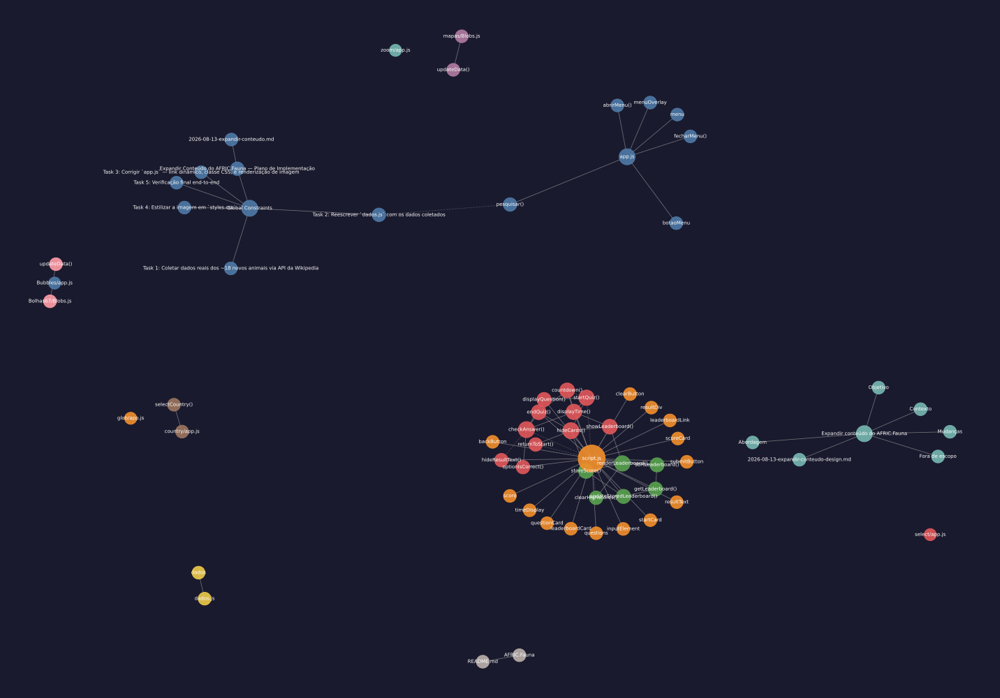

<p align="center">
  <picture>
    <source media="(prefers-color-scheme: dark)" srcset="https://shieldcn.dev/header/graph.svg?title=AFRIC.Fauna&subtitle=Biodiversidade+e+Conserva%C3%A7%C3%A3o+da+Fauna+Africana&logo=safari&theme=emerald&mode=dark" />
    
  </picture>
</p>

<p align="center">
  <a href="https://github.com/MisterAntoY/Afric.Fauna"></a>
  <a href="https://github.com/MisterAntoY/Afric.Fauna"></a>
  <a href="https://github.com/MisterAntoY/Afric.Fauna/blob/main/LICENSE"></a>
  
</p>

<p align="center">
  <a href="https://react.dev/"></a>
  <a href="https://www.typescriptlang.org/"></a>
  <a href="https://vite.dev/"></a>
  <a href="https://tailwindcss.com/"></a>
  <a href="https://maplibre.org/"></a>
</p>

---

> *"Todo jovem gafanhoto tem o seu primeiro projectinho de estudo, e este é o meu. Uma plataforma dedicada a explorar e compartilhar informações sobre a fauna africana."* — **MisterAntoY**

**AFRIC.Fauna** é uma plataforma web interactiva e educativa projectada para mapear, catalogar e promover a conservação da biodiversidade do continente africano. Combinando cartografia moderna, dados biológicos detalhados e gamificação através de quizzes interactivos, o projecto torna o conhecimento da fauna africana acessível e envolvente.

---

## 🦁 Funcionalidades Principais

- 🔍 **Motor de Busca e Filtro de Espécies**: Localização instantânea de animais africanos por nome, habitat, hábitos alimentares e estado de conservação.
- 🗺️ **Mapeamento Geoespacial Interativo**: Visualização da distribuição geográfica e biomas africanos utilizando **MapLibre GL** e **@mapcn/map**.
- 🧠 **Quiz Educativo "JimBongo"**: Módulo interactivo de perguntas e respostas para testar e consolidar conhecimentos sobre a vida selvagem.
- 🌍 **Foco em Conservação e Educação Ambiental**: Informações dedicadas à consciencialização sobre espécies em vias de extinção e proteção de habitats naturais em Angola e África.

---

## 🛠️ Tecnologias Utilizadas

| Tecnologia | Descrição |
| :--- | :--- |
| **React 19** | Biblioteca para interfaces de utilizador modulares e reativas |
| **TypeScript 5.7** | Tipagem estática rigorosa para dados geoespaciais e biológicos |
| **Vite 6** | Bundler de última geração com inicialização ultrarrápida |
| **Tailwind CSS 4** | Estilização moderna com CSS-first architecture |
| **MapLibre GL & @mapcn/map** | Renderização vetorial fluida de mapas geográficos da África |
| **Lucide React** | Conjunto coeso de ícones vetoriais modernos |

---

## 📂 Estrutura do Projecto

```text
Afric.Fauna/
├── mapas/                  # Camadas cartográficas e dados geográficos
├── quiz-jimbongo/          # Módulo interactivo do quiz educativo
├── src/
│   ├── components/ui/map.tsx # Componente de mapas reativo com MapLibre GL
│   ├── lib/utils.ts        # Utilitários de classes e manipulação de estado
│   └── index.css           # Configurações de tema e Tailwind CSS 4
├── dados.js                # Base de dados estruturada das espécies animais
├── index.html              # Ponto de entrada da aplicação web
├── vite.config.ts          # Configurações do Vite e plugins React
└── package.json            # Metadados e dependências do projecto
```

---

## 🚀 Como Executar Localmente

### Pré-requisitos
- **Node.js** >= 18 (recomendado Node 22+)
- Gestor de pacotes **npm** ou **pnpm**

### Passos de Instalação

```bash
# 1. Clonar o repositório
git clone https://github.com/MisterAntoY/Afric.Fauna.git
cd Afric.Fauna

# 2. Instalar as dependências
npm install

# 3. Iniciar o servidor de desenvolvimento
npm run dev
```

Aceda à aplicação em `http://localhost:5173`.

---

## 🗺️ Mapa Arquitetural & Grafo de Dependências

Grafo estrutural e comunidades extraído via [graphify](https://github.com/Graphify-Labs/graphify):

[](./graphify-out/GRAPH_REPORT.md)

- 📊 **Relatório Arquitetural:** [graphify-out/GRAPH_REPORT.md](./graphify-out/GRAPH_REPORT.md)
- 🌐 **Navegador Interativo (HTML):** Abra [`graphify-out/graph.html`](./graphify-out/graph.html) no navegador
- 🔀 **Fluxo de Chamadas & Diagramas:** Abra [`graphify-out/Afric.Fauna-callflow.html`](./graphify-out/Afric.Fauna-callflow.html) para diagramas interativos

---

## 📄 Licença

Este projecto está licenciado sob a Licença MIT — consulte o ficheiro [LICENSE](LICENSE) para obter mais detalhes.

<p align="center">
  <sub>Desenvolvido com dedicação por <b><a href="https://github.com/MisterAntoY">MisterAntoY</a></b> 🇦🇴 | Feito com <a href="https://shieldcn.dev">shieldcn</a></sub>
</p>
